<p align='center'>
  
</p>

<p align='center'>TypeScript tür challenge'larından oluşan bir koleksiyon</p>

<p align='center'>
  <a href='https://discord.gg/UgKBCq9'>
    
  </a>
  <a href='https://www.typescriptlang.org/play?install-plugin=%40typescript%2Fplayground-plugin'>
    
  </a>
</p>

<br>

<p align='center'>
  <a href='./README.md'>English</a> | Türkçe | <a href='./README.zh-CN.md'>简体中文</a> | <a href='./README.ja.md'>日本語</a> | <a href='./README.ko.md'>한국어</a> | <a href='./README.pt-BR.md'>Português</a>
</p>

## Giriş

Kaliteli türler, olası hataları önlerken projelerin bakımını kolaylaştırabilir.

Bu proje, tür sisteminin nasıl çalıştığını daha iyi anlamanıza, kendi yardımcı türlerinizi yazmanıza veya yalnızca challenge'larla eğlenmenize yardımcı olmayı amaçlar. Ayrıca gerçek dünyada karşılaştığınız soruları sorabileceğiniz ve yanıtlayabileceğiniz bir topluluk oluşturmaya çalışıyoruz; bu sorular ileride challenge'lara da dönüşebilir.

## Challenge'lar

> Challenge ayrıntılarını görmek için aşağıdaki bağlantılara tıklayın.

> **Not:** Challenge'lar [strict mode](https://www.typescriptlang.org/tsconfig#strict) ile çalışır.

Türkçe çeviriler temel challenge'larla başlayarak aşamalı olarak genişletilmektedir:

- [13 · Merhaba Dünya](./questions/00013-warm-hello-world/README.tr.md)
- [4 · Pick'i Uygulama](./questions/00004-easy-pick/README.tr.md)
- [7 · Readonly](./questions/00007-easy-readonly/README.tr.md)
- [11 · Tuple'dan Nesneye](./questions/00011-easy-tuple-to-object/README.tr.md)
- [14 · Dizinin İlk Elemanı](./questions/00014-easy-first/README.tr.md)

Çevrilmemiş challenge'ların tamamına [İngilizce ana sayfadan](./README.md) ulaşabilirsiniz.

## Önerilen okumalar

- [TypeScript Handbook](https://www.typescriptlang.org/docs/handbook/intro.html)
- [type-fest](https://github.com/sindresorhus/type-fest)
- [utility-types](https://github.com/piotrwitek/utility-types)
- [ts-toolbelt](https://github.com/millsp/ts-toolbelt)

## Katkıda bulunma

Yeni challenge'lar ekleyebilir, mevcut challenge'ları iyileştirebilir veya Türkçe çevirileri genişletebilirsiniz. Ayrıntılı katkı yönergeleri için [İngilizce README'deki katkı bölümüne](./README.md#how-to-contribute) bakın.

## Yerel çalıştırma

Projeyi yerel olarak çalıştırmak için:

```bash
pnpm install
pnpm dev
```

## Lisans

MIT
